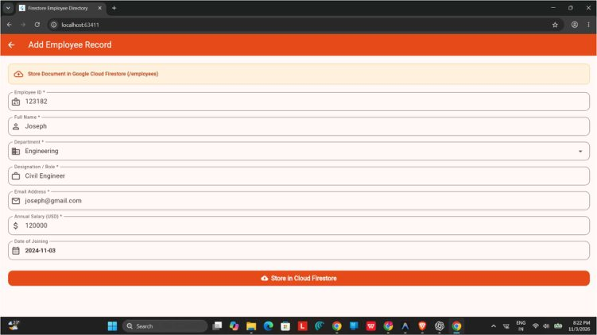
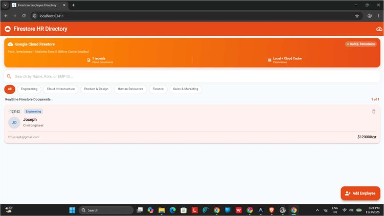

# Ex. No. 7: Firestore Employee Record Manager

Kevin Kattakayam | URK23CS7081  
24CS2016 - Building Applications using Flutter  
Date of Exercise: 2026-09-21  
Github Code Link (Keep as public): https://github.com/Kevin-Kattakayam/exp7

## Aim

To create a Flutter employee directory that reads employee records from Cloud Firestore and supports adding, searching, filtering, and deleting records.

## Description

The Employee model converts employee fields to and from Firestore documents. A Firestore service initializes the connection, exposes a real-time employee stream, retrieves records, adds and deletes documents, checks duplicate employee IDs, and includes sample data with a local demo cache. The screen filters the stream by department and searches employee name, role, or ID. A form validates and submits new employee details; employee cards and detail sheets present each record.

## Program

### lib/main.dart

```dart
import 'package:flutter/material.dart';
import 'screens/employee_list_screen.dart';
import 'services/firestore_service.dart';

void main() async {
  WidgetsFlutterBinding.ensureInitialized();

  // Initialize Firebase and Google Cloud Firestore with offline persistence
  await FirestoreService.instance.initialize();

  runApp(const FirestoreEmployeeApp());
}

/// Root widget for the Google Cloud Firestore Employee Directory app.
class FirestoreEmployeeApp extends StatelessWidget {
  const FirestoreEmployeeApp({super.key});

  @override
  Widget build(BuildContext context) {
    return MaterialApp(
      title: 'Firestore Employee Directory',
      debugShowCheckedModeBanner: false,
      theme: ThemeData(
        colorSchemeSeed: Colors.deepOrange,
        useMaterial3: true,
      ),
      home: const EmployeeListScreen(),
    );
  }
}
```

### lib/firebase_options.dart

```dart
import 'package:firebase_core/firebase_core.dart' show FirebaseOptions;
import 'package:flutter/foundation.dart'
    show defaultTargetPlatform, kIsWeb, TargetPlatform;

/// Default [FirebaseOptions] for use with your Firebase apps.
/// Provides configuration for Google Cloud Firestore.
class DefaultFirebaseOptions {
  static FirebaseOptions get currentPlatform {
    if (kIsWeb) {
      return web;
    }
    switch (defaultTargetPlatform) {
      case TargetPlatform.android:
        return android;
      case TargetPlatform.iOS:
        return ios;
      case TargetPlatform.macOS:
        return macos;
      case TargetPlatform.windows:
        return windows;
      case TargetPlatform.linux:
        throw UnsupportedError(
          'DefaultFirebaseOptions have not been configured for linux.',
        );
      default:
        return android;
    }
  }

  static const FirebaseOptions web = FirebaseOptions(
    apiKey: 'AIzaSyDemoFirestoreApiKeyWeb1234567890',
    appId: '1:123456789012:web:abcdef1234567890abcdef',
    messagingSenderId: '123456789012',
    projectId: 'firestore-employee-lab-exp7',
    authDomain: 'firestore-employee-lab-exp7.firebaseapp.com',
    storageBucket: 'firestore-employee-lab-exp7.appspot.com',
  );

  static const FirebaseOptions android = FirebaseOptions(
    apiKey: 'AIzaSyDemoFirestoreApiKeyAndroid123456',
    appId: '1:123456789012:android:abcdef1234567890abcd',
    messagingSenderId: '123456789012',
    projectId: 'firestore-employee-lab-exp7',
    storageBucket: 'firestore-employee-lab-exp7.appspot.com',
  );

  static const FirebaseOptions ios = FirebaseOptions(
    apiKey: 'AIzaSyDemoFirestoreApiKeyIos1234567890',
    appId: '1:123456789012:ios:abcdef1234567890abcdef',
    messagingSenderId: '123456789012',
    projectId: 'firestore-employee-lab-exp7',
    storageBucket: 'firestore-employee-lab-exp7.appspot.com',
    iosBundleId: 'com.example.firestoreEmployeeApp',
  );

  static const FirebaseOptions macos = FirebaseOptions(
    apiKey: 'AIzaSyDemoFirestoreApiKeyMacos12345678',
    appId: '1:123456789012:ios:abcdef1234567890abcdef',
    messagingSenderId: '123456789012',
    projectId: 'firestore-employee-lab-exp7',
    storageBucket: 'firestore-employee-lab-exp7.appspot.com',
    iosBundleId: 'com.example.firestoreEmployeeApp',
  );

  static const FirebaseOptions windows = FirebaseOptions(
    apiKey: 'AIzaSyDemoFirestoreApiKeyWin1234567890',
    appId: '1:123456789012:web:abcdef1234567890abcdef',
    messagingSenderId: '123456789012',
    projectId: 'firestore-employee-lab-exp7',
    storageBucket: 'firestore-employee-lab-exp7.appspot.com',
  );
}
```

### lib/models/employee.dart

```dart
/// Data model representing an Employee record stored in Google Cloud Firestore.
class Employee {
  final String? id; // Firestore document ID
  final String employeeId; // e.g. 'EMP-2026-101'
  final String name;
  final String department;
  final String designation;
  final String email;
  final double salary;
  final String joiningDate;

  const Employee({
    this.id,
    required this.employeeId,
    required this.name,
    required this.department,
    required this.designation,
    required this.email,
    required this.salary,
    required this.joiningDate,
  });

  /// Convert Employee to Map for Firestore document insertion.
  Map<String, dynamic> toFirestore() {
    return {
      'employeeId': employeeId,
      'name': name,
      'department': department,
      'designation': designation,
      'email': email,
      'salary': salary,
      'joiningDate': joiningDate,
      'updatedAt': DateTime.now().toIso8601String(),
    };
  }

  /// Factory constructor to parse document data and document ID from Firestore.
  factory Employee.fromMap(Map<String, dynamic> map, String id) {
    return Employee(
      id: id,
      employeeId: map['employeeId'] as String? ?? 'EMP-UNKNOWN',
      name: map['name'] as String? ?? 'Unnamed',
      department: map['department'] as String? ?? 'General',
      designation: map['designation'] as String? ?? 'Associate',
      email: map['email'] as String? ?? 'no-email@company.com',
      salary: (map['salary'] as num?)?.toDouble() ?? 0.0,
      joiningDate: map['joiningDate'] as String? ?? '2024-01-01',
    );
  }

  Employee copyWith({
    String? id,
    String? employeeId,
    String? name,
    String? department,
    String? designation,
    String? email,
    double? salary,
    String? joiningDate,
  }) {
    return Employee(
      id: id ?? this.id,
      employeeId: employeeId ?? this.employeeId,
      name: name ?? this.name,
      department: department ?? this.department,
      designation: designation ?? this.designation,
      email: email ?? this.email,
      salary: salary ?? this.salary,
      joiningDate: joiningDate ?? this.joiningDate,
    );
  }
}
```

### lib/screens/add_employee_screen.dart

```dart
import 'package:flutter/material.dart';
import 'package:flutter/services.dart';
import '../models/employee.dart';
import '../services/firestore_service.dart';

/// Form screen to CREATE and store employee records in Google Cloud Firestore.
class AddEmployeeScreen extends StatefulWidget {
  const AddEmployeeScreen({super.key});

  @override
  State<AddEmployeeScreen> createState() => _AddEmployeeScreenState();
}

class _AddEmployeeScreenState extends State<AddEmployeeScreen> {
  final _formKey = GlobalKey<FormState>();

  final _empIdController = TextEditingController();
  final _nameController = TextEditingController();
  final _designationController = TextEditingController();
  final _emailController = TextEditingController();
  final _salaryController = TextEditingController();

  String _selectedDepartment = 'Engineering';
  DateTime _joiningDate = DateTime.now();
  bool _isSubmitting = false;

  final List<String> _departments = [
    'Engineering',
    'Cloud Infrastructure',
    'Product & Design',
    'Human Resources',
    'Finance',
    'Sales & Marketing',
  ];

  @override
  void dispose() {
    _empIdController.dispose();
    _nameController.dispose();
    _designationController.dispose();
    _emailController.dispose();
    _salaryController.dispose();
    super.dispose();
  }

  String get _formattedDate =>
      '${_joiningDate.year}-${_joiningDate.month.toString().padLeft(2, '0')}-${_joiningDate.day.toString().padLeft(2, '0')}';

  Future<void> _pickDate() async {
    final picked = await showDatePicker(
      context: context,
      initialDate: _joiningDate,
      firstDate: DateTime(2015),
      lastDate: DateTime.now().add(const Duration(days: 365)),
    );
    if (picked != null) {
      setState(() {
        _joiningDate = picked;
      });
    }
  }

  Future<void> _submitToFirestore() async {
    FocusScope.of(context).unfocus();

    if (!_formKey.currentState!.validate()) return;

    final empId = _empIdController.text.trim();

    setState(() {
      _isSubmitting = true;
    });

    try {
      final exists = await FirestoreService.instance.employeeIdExists(empId);
      if (exists) {
        if (!mounted) return;
        setState(() {
          _isSubmitting = false;
        });
        ScaffoldMessenger.of(context).showSnackBar(
          SnackBar(
            content: Text('Employee ID "$empId" already exists in Firestore!'),
            backgroundColor: Colors.red[800],
          ),
        );
        return;
      }

      final employee = Employee(
        employeeId: empId,
        name: _nameController.text.trim(),
        department: _selectedDepartment,
        designation: _designationController.text.trim(),
        email: _emailController.text.trim(),
        salary: double.parse(_salaryController.text.trim()),
        joiningDate: _formattedDate,
      );

      final docId = await FirestoreService.instance.addEmployee(employee);

      if (!mounted) return;

      ScaffoldMessenger.of(context).showSnackBar(
        SnackBar(
          content: Text(
            'Employee stored in Cloud Firestore! (Doc: $docId)',
          ),
          backgroundColor: Colors.deepOrange[700],
          duration: const Duration(seconds: 2),
        ),
      );

      Navigator.pop(context, true);
    } catch (e) {
      if (!mounted) return;
      setState(() {
        _isSubmitting = false;
      });
      ScaffoldMessenger.of(context).showSnackBar(
        SnackBar(
          content: Text('Firestore write error: $e'),
          backgroundColor: Colors.red[800],
        ),
      );
    }
  }

  @override
  Widget build(BuildContext context) {
    return Scaffold(
      appBar: AppBar(
        title: const Text('Add Employee Record'),
        backgroundColor: Colors.deepOrange[700],
        foregroundColor: Colors.white,
      ),
      body: SingleChildScrollView(
        padding: const EdgeInsets.all(20),
        child: Form(
          key: _formKey,
          child: Column(
            crossAxisAlignment: CrossAxisAlignment.stretch,
            children: [
              // Info Banner
              Container(
                padding: const EdgeInsets.all(14),
                decoration: BoxDecoration(
                  color: Colors.orange[50],
                  borderRadius: BorderRadius.circular(12),
                  border: Border.all(color: Colors.orange[200]!),
                ),
                child: Row(
                  children: [
                    Icon(Icons.cloud_upload_outlined, color: Colors.deepOrange[800]),
                    const SizedBox(width: 12),
                    Expanded(
                      child: Text(
                        'Store Document in Google Cloud Firestore (/employees)',
                        style: TextStyle(
                          fontSize: 13,
                          fontWeight: FontWeight.bold,
                          color: Colors.deepOrange[900],
                        ),
                      ),
                    ),
                  ],
                ),
              ),
              const SizedBox(height: 20),

              // Employee ID
              TextFormField(
                controller: _empIdController,
                textCapitalization: TextCapitalization.characters,
                decoration: InputDecoration(
                  labelText: 'Employee ID *',
                  hintText: 'e.g., EMP-2026-105',
                  prefixIcon: const Icon(Icons.badge_outlined),
                  border: OutlineInputBorder(borderRadius: BorderRadius.circular(12)),
                ),
                validator: (val) {
                  if (val == null || val.trim().isEmpty) {
                    return 'Please enter Employee ID';
                  }
                  if (val.trim().length < 4) {
                    return 'Employee ID must be at least 4 characters';
                  }
                  return null;
                },
              ),
              const SizedBox(height: 16),

              // Full Name
              TextFormField(
                controller: _nameController,
                textCapitalization: TextCapitalization.words,
                decoration: InputDecoration(
                  labelText: 'Full Name *',
                  hintText: 'e.g., Alexander Hayes',
                  prefixIcon: const Icon(Icons.person_outline),
                  border: OutlineInputBorder(borderRadius: BorderRadius.circular(12)),
                ),
                validator: (val) {
                  if (val == null || val.trim().isEmpty) {
                    return 'Please enter employee name';
                  }
                  return null;
                },
              ),
              const SizedBox(height: 16),

              // Department Dropdown
              DropdownButtonFormField<String>(
                initialValue: _selectedDepartment,
                decoration: InputDecoration(
                  labelText: 'Department *',
                  prefixIcon: const Icon(Icons.business_outlined),
                  border: OutlineInputBorder(borderRadius: BorderRadius.circular(12)),
                ),
                items: _departments.map((dept) {
                  return DropdownMenuItem(value: dept, child: Text(dept));
                }).toList(),
                onChanged: (val) {
                  if (val != null) {
                    setState(() {
                      _selectedDepartment = val;
                    });
                  }
                },
              ),
              const SizedBox(height: 16),

              // Designation
              TextFormField(
                controller: _designationController,
                textCapitalization: TextCapitalization.words,
                decoration: InputDecoration(
                  labelText: 'Designation / Role *',
                  hintText: 'e.g., Senior Systems Architect',
                  prefixIcon: const Icon(Icons.work_outline),
                  border: OutlineInputBorder(borderRadius: BorderRadius.circular(12)),
                ),
                validator: (val) {
                  if (val == null || val.trim().isEmpty) {
                    return 'Please enter designation';
                  }
                  return null;
                },
              ),
              const SizedBox(height: 16),

              // Email
              TextFormField(
                controller: _emailController,
                keyboardType: TextInputType.emailAddress,
                decoration: InputDecoration(
                  labelText: 'Email Address *',
                  hintText: 'e.g., alex.h@cloudcorp.io',
                  prefixIcon: const Icon(Icons.email_outlined),
                  border: OutlineInputBorder(borderRadius: BorderRadius.circular(12)),
                ),
                validator: (val) {
                  if (val == null || val.trim().isEmpty) {
                    return 'Please enter email address';
                  }
                  final emailRegex = RegExp(r'^[\w-\.]+@([\w-]+\.)+[\w-]{2,4}$');
                  if (!emailRegex.hasMatch(val.trim())) {
                    return 'Please enter a valid email address';
                  }
                  return null;
                },
              ),
              const SizedBox(height: 16),

              // Annual Salary
              TextFormField(
                controller: _salaryController,
                keyboardType: const TextInputType.numberWithOptions(decimal: true),
                inputFormatters: [
                  FilteringTextInputFormatter.allow(RegExp(r'^\d*\.?\d*')),
                ],
                decoration: InputDecoration(
                  labelText: 'Annual Salary (USD) *',
                  hintText: 'e.g., 125000',
                  prefixIcon: const Icon(Icons.attach_money),
                  border: OutlineInputBorder(borderRadius: BorderRadius.circular(12)),
                ),
                validator: (val) {
                  if (val == null || val.trim().isEmpty) {
                    return 'Please enter salary';
                  }
                  final num = double.tryParse(val.trim());
                  if (num == null || num <= 0) {
                    return 'Please enter a valid positive salary';
                  }
                  return null;
                },
              ),
              const SizedBox(height: 16),

              // Joining Date Picker
              InkWell(
                onTap: _pickDate,
                borderRadius: BorderRadius.circular(12),
                child: InputDecorator(
                  decoration: InputDecoration(
                    labelText: 'Date of Joining',
                    prefixIcon: const Icon(Icons.calendar_month_outlined),
                    border: OutlineInputBorder(borderRadius: BorderRadius.circular(12)),
                  ),
                  child: Text(
                    _formattedDate,
                    style: const TextStyle(fontSize: 15, fontWeight: FontWeight.w600),
                  ),
                ),
              ),
              const SizedBox(height: 28),

              // Submit Button
              ElevatedButton.icon(
                onPressed: _isSubmitting ? null : _submitToFirestore,
                icon: _isSubmitting
                    ? const SizedBox(
                        width: 20,
                        height: 20,
                        child: CircularProgressIndicator(
                          color: Colors.white,
                          strokeWidth: 2,
                        ),
                      )
                    : const Icon(Icons.cloud_upload, color: Colors.white),
                label: Text(
                  _isSubmitting
                      ? 'Saving to Firestore...'
                      : 'Store in Cloud Firestore',
                  style: const TextStyle(
                    color: Colors.white,
                    fontSize: 16,
                    fontWeight: FontWeight.bold,
                  ),
                ),
                style: ElevatedButton.styleFrom(
                  backgroundColor: Colors.deepOrange[700],
                  padding: const EdgeInsets.symmetric(vertical: 16),
                  shape: RoundedRectangleBorder(
                    borderRadius: BorderRadius.circular(12),
                  ),
                ),
              ),
            ],
          ),
        ),
      ),
    );
  }
}
```

### lib/screens/employee_list_screen.dart

```dart
import 'package:flutter/material.dart';
import '../models/employee.dart';
import '../services/firestore_service.dart';
import '../widgets/employee_card.dart';
import '../widgets/employee_details_sheet.dart';
import '../widgets/firestore_status_banner.dart';
import 'add_employee_screen.dart';

/// Main screen displaying employee records RETRIEVED in real-time from Google Cloud Firestore.
class EmployeeListScreen extends StatefulWidget {
  const EmployeeListScreen({super.key});

  @override
  State<EmployeeListScreen> createState() => _EmployeeListScreenState();
}

class _EmployeeListScreenState extends State<EmployeeListScreen> {
  final TextEditingController _searchController = TextEditingController();

  String _searchQuery = '';
  String _selectedDepartment = 'All';

  final List<String> _departmentFilters = [
    'All',
    'Engineering',
    'Cloud Infrastructure',
    'Product & Design',
    'Human Resources',
    'Finance',
    'Sales & Marketing',
  ];

  @override
  void dispose() {
    _searchController.dispose();
    super.dispose();
  }

  void _navigateToAddEmployee() {
    Navigator.push(
      context,
      MaterialPageRoute(builder: (_) => const AddEmployeeScreen()),
    );
  }

  Future<void> _deleteEmployee(Employee employee) async {
    final confirmed = await showDialog<bool>(
      context: context,
      builder: (ctx) => AlertDialog(
        title: const Text('Delete from Firestore?'),
        content: Text(
          'Are you sure you want to delete "${employee.name}" (${employee.employeeId}) from Cloud Firestore?',
        ),
        actions: [
          TextButton(
            onPressed: () => Navigator.pop(ctx, false),
            child: const Text('Cancel'),
          ),
          ElevatedButton(
            style: ElevatedButton.styleFrom(backgroundColor: Colors.red),
            onPressed: () => Navigator.pop(ctx, true),
            child: const Text('Delete', style: TextStyle(color: Colors.white)),
          ),
        ],
      ),
    );

    if (confirmed == true && employee.id != null) {
      await FirestoreService.instance.deleteEmployee(employee.id!);
      if (mounted) {
        ScaffoldMessenger.of(context).showSnackBar(
          SnackBar(
            content: Text('Deleted "${employee.name}" from Firestore'),
            backgroundColor: Colors.grey[800],
            duration: const Duration(seconds: 2),
          ),
        );
      }
    }
  }

  List<Employee> _filterByQuery(List<Employee> employees) {
    if (_searchQuery.trim().isEmpty) return employees;
    final q = _searchQuery.toLowerCase();
    return employees.where((emp) {
      return emp.name.toLowerCase().contains(q) ||
          emp.employeeId.toLowerCase().contains(q) ||
          emp.designation.toLowerCase().contains(q) ||
          emp.department.toLowerCase().contains(q);
    }).toList();
  }

  @override
  Widget build(BuildContext context) {
    return Scaffold(
      backgroundColor: const Color(0xFFF9FAFB),
      appBar: AppBar(
        title: const Row(
          children: [
            Icon(Icons.cloud_circle_rounded, color: Colors.white, size: 28),
            SizedBox(width: 10),
            Text(
              'Firestore HR Directory',
              style: TextStyle(fontWeight: FontWeight.bold),
            ),
          ],
        ),
        backgroundColor: Colors.deepOrange[700],
        foregroundColor: Colors.white,
        elevation: 0,
        actions: [
          IconButton(
            icon: const Icon(Icons.cloud_download_outlined),
            tooltip: 'Seed Firestore Data',
            onPressed: () async {
              final messenger = ScaffoldMessenger.of(context);
              await FirestoreService.instance.seedSampleData();
              messenger.showSnackBar(
                const SnackBar(
                  content: Text('Sample documents seeded to Cloud Firestore!'),
                  backgroundColor: Colors.deepOrange,
                ),
              );
            },
          ),
        ],
      ),
      body: StreamBuilder<List<Employee>>(
        stream: FirestoreService.instance.getEmployeesStream(
          departmentFilter: _selectedDepartment,
        ),
        builder: (context, snapshot) {
          if (snapshot.connectionState == ConnectionState.waiting &&
              !snapshot.hasData) {
            return const Center(
              child: CircularProgressIndicator(color: Colors.deepOrange),
            );
          }

          final allEmployees = snapshot.data ?? [];
          final filteredEmployees = _filterByQuery(allEmployees);

          return Column(
            children: [
              // Cloud Status Banner
              FirestoreStatusBanner(
                isOnlineSync: FirestoreService.instance.isFirebaseInitialized,
                recordCount: allEmployees.length,
              ),

              // Search Box
              Container(
                margin: const EdgeInsets.symmetric(horizontal: 16, vertical: 4),
                decoration: BoxDecoration(
                  color: Colors.white,
                  borderRadius: BorderRadius.circular(14),
                  boxShadow: [
                    BoxShadow(
                      color: Colors.grey.withValues(alpha: 0.1),
                      blurRadius: 8,
                      offset: const Offset(0, 2),
                    ),
                  ],
                ),
                child: TextField(
                  controller: _searchController,
                  onChanged: (val) {
                    setState(() {
                      _searchQuery = val;
                    });
                  },
                  decoration: InputDecoration(
                    hintText: 'Search by Name, Role, or EMP ID...',
                    hintStyle: TextStyle(color: Colors.grey[400], fontSize: 14),
                    prefixIcon:
                        Icon(Icons.search, color: Colors.deepOrange[300]),
                    suffixIcon: _searchController.text.isNotEmpty
                        ? IconButton(
                            icon: Icon(Icons.clear, color: Colors.grey[400]),
                            onPressed: () {
                              _searchController.clear();
                              setState(() {
                                _searchQuery = '';
                              });
                            },
                          )
                        : null,
                    border: InputBorder.none,
                    contentPadding: const EdgeInsets.symmetric(
                      horizontal: 16,
                      vertical: 14,
                    ),
                  ),
                ),
              ),

              // Department Horizontal Filter Chips
              SizedBox(
                height: 48,
                child: ListView.separated(
                  scrollDirection: Axis.horizontal,
                  padding:
                      const EdgeInsets.symmetric(horizontal: 16, vertical: 6),
                  itemCount: _departmentFilters.length,
                  separatorBuilder: (_, _) => const SizedBox(width: 8),
                  itemBuilder: (context, index) {
                    final dept = _departmentFilters[index];
                    final isSelected = _selectedDepartment == dept;
                    return GestureDetector(
                      onTap: () {
                        setState(() {
                          _selectedDepartment = dept;
                        });
                      },
                      child: AnimatedContainer(
                        duration: const Duration(milliseconds: 200),
                        padding: const EdgeInsets.symmetric(
                            horizontal: 14, vertical: 6),
                        decoration: BoxDecoration(
                          color: isSelected
                              ? Colors.deepOrange[700]
                              : Colors.white,
                          borderRadius: BorderRadius.circular(20),
                          border: Border.all(
                            color: isSelected
                                ? Colors.deepOrange[700]!
                                : Colors.grey[300]!,
                          ),
                        ),
                        child: Text(
                          dept,
                          style: TextStyle(
                            fontSize: 12,
                            fontWeight: isSelected
                                ? FontWeight.bold
                                : FontWeight.w500,
                            color:
                                isSelected ? Colors.white : Colors.grey[800],
                          ),
                        ),
                      ),
                    );
                  },
                ),
              ),

              // Results count header
              Padding(
                padding:
                    const EdgeInsets.symmetric(horizontal: 20, vertical: 6),
                child: Row(
                  mainAxisAlignment: MainAxisAlignment.spaceBetween,
                  children: [
                    Text(
                      'Realtime Firestore Documents',
                      style: TextStyle(
                        fontSize: 13,
                        fontWeight: FontWeight.bold,
                        color: Colors.grey[800],
                      ),
                    ),
                    Text(
                      '${filteredEmployees.length} of ${allEmployees.length}',
                      style: TextStyle(
                        fontSize: 12,
                        fontWeight: FontWeight.w600,
                        color: Colors.deepOrange[800],
                      ),
                    ),
                  ],
                ),
              ),

              // List of Employee Cards
              Expanded(
                child: filteredEmployees.isEmpty
                    ? _buildEmptyState()
                    : ListView.builder(
                        padding: const EdgeInsets.only(bottom: 80),
                        itemCount: filteredEmployees.length,
                        itemBuilder: (context, index) {
                          final emp = filteredEmployees[index];
                          return EmployeeCard(
                            employee: emp,
                            onTap: () =>
                                EmployeeDetailsSheet.show(context, emp),
                            onDelete: () => _deleteEmployee(emp),
                          );
                        },
                      ),
              ),
            ],
          );
        },
      ),
      floatingActionButton: FloatingActionButton.extended(
        onPressed: _navigateToAddEmployee,
        backgroundColor: Colors.deepOrange[700],
        foregroundColor: Colors.white,
        icon: const Icon(Icons.person_add_alt_1),
        label: const Text(
          'Add Employee',
          style: TextStyle(fontWeight: FontWeight.bold),
        ),
      ),
    );
  }

  Widget _buildEmptyState() {
    return Center(
      child: SingleChildScrollView(
        padding: const EdgeInsets.all(32),
        child: Column(
          mainAxisAlignment: MainAxisAlignment.center,
          children: [
            Icon(Icons.cloud_off_rounded, size: 64, color: Colors.grey[400]),
            const SizedBox(height: 16),
            const Text(
              'No Employee Documents in Firestore',
              style: TextStyle(fontSize: 18, fontWeight: FontWeight.bold),
              textAlign: TextAlign.center,
            ),
            const SizedBox(height: 8),
            Text(
              'Add employee documents using the form or click Seed Firestore Data to populate sample records.',
              style: TextStyle(fontSize: 13, color: Colors.grey[600]),
              textAlign: TextAlign.center,
            ),
            const SizedBox(height: 20),
            ElevatedButton.icon(
              onPressed: () => FirestoreService.instance.seedSampleData(),
              style: ElevatedButton.styleFrom(
                backgroundColor: Colors.deepOrange[700],
                foregroundColor: Colors.white,
              ),
              icon: const Icon(Icons.cloud_download),
              label: const Text('Seed Firestore Documents'),
            ),
          ],
        ),
      ),
    );
  }
}
```

### lib/services/firestore_service.dart

```dart
import 'dart:async';
import 'package:cloud_firestore/cloud_firestore.dart';
import 'package:firebase_core/firebase_core.dart';
import '../firebase_options.dart';
import '../models/employee.dart';

/// Centralized service handling Google Cloud Firestore storage, queries, and streams.
class FirestoreService {
  static const String collectionName = 'employees';

  // Singleton instance
  FirestoreService._internal();
  static final FirestoreService instance = FirestoreService._internal();

  bool _isFirebaseInitialized = false;
  bool get isFirebaseInitialized => _isFirebaseInitialized;

  FirebaseFirestore? _firestore;

  // In-memory fallback repository for offline/unconfigured environments
  final List<Employee> _localCache = [];
  final StreamController<List<Employee>> _localStreamController =
      StreamController<List<Employee>>.broadcast();

  /// Initialize Firebase Core and Cloud Firestore settings.
  Future<void> initialize() async {
    try {
      if (Firebase.apps.isEmpty) {
        await Firebase.initializeApp(
          options: DefaultFirebaseOptions.currentPlatform,
        );
      }
      _firestore = FirebaseFirestore.instance;

      // Enable offline persistence in Cloud Firestore
      _firestore!.settings = const Settings(
        persistenceEnabled: true,
        cacheSizeBytes: Settings.CACHE_SIZE_UNLIMITED,
      );

      _isFirebaseInitialized = true;
    } catch (_) {
      // Graceful fallback to persistent local cache if running in demo/offline mode
      _isFirebaseInitialized = false;
      _initDemoData();
    }
  }

  void _initDemoData() {
    if (_localCache.isEmpty) {
      _localCache.addAll([
        const Employee(
          id: 'doc_emp_001',
          employeeId: 'EMP-1001',
          name: 'Sarah Connor',
          department: 'Engineering',
          designation: 'Staff Mobile Architect',
          email: 'sarah.c@cloudcorp.io',
          salary: 135000.0,
          joiningDate: '2023-03-15',
        ),
        const Employee(
          id: 'doc_emp_002',
          employeeId: 'EMP-1002',
          name: 'David Kim',
          department: 'Cloud Infrastructure',
          designation: 'DevOps & Firestore Lead',
          email: 'david.k@cloudcorp.io',
          salary: 128000.0,
          joiningDate: '2023-06-01',
        ),
        const Employee(
          id: 'doc_emp_003',
          employeeId: 'EMP-1003',
          name: 'Aisha Morales',
          department: 'Product & Design',
          designation: 'Principal UI/UX Designer',
          email: 'aisha.m@cloudcorp.io',
          salary: 118000.0,
          joiningDate: '2023-08-20',
        ),
        const Employee(
          id: 'doc_emp_004',
          employeeId: 'EMP-1004',
          name: 'Marcus Vance',
          department: 'Engineering',
          designation: 'Senior Backend Engineer',
          email: 'marcus.v@cloudcorp.io',
          salary: 122000.0,
          joiningDate: '2024-01-10',
        ),
      ]);
      _localStreamController.add(List.unmodifiable(_localCache));
    }
  }

  // ==================== FIRESTORE STREAMS & READS ====================

  /// Stream of all employee documents in real-time.
  Stream<List<Employee>> getEmployeesStream({String? departmentFilter}) {
    if (_isFirebaseInitialized && _firestore != null) {
      try {
        Query<Map<String, dynamic>> query =
            _firestore!.collection(collectionName);

        if (departmentFilter != null && departmentFilter != 'All') {
          query = query.where('department', isEqualTo: departmentFilter);
        }

        return query.snapshots().map((snapshot) {
          return snapshot.docs.map((doc) {
            return Employee.fromMap(doc.data(), doc.id);
          }).toList();
        });
      } catch (_) {
        // Fallback to local stream on unexpected exception
      }
    }

    // Local stream emission
    Future.microtask(() {
      final list = departmentFilter == null || departmentFilter == 'All'
          ? _localCache
          : _localCache
              .where((e) => e.department == departmentFilter)
              .toList();
      _localStreamController.add(List.unmodifiable(list));
    });

    return _localStreamController.stream;
  }

  /// One-time fetch of all employees from Cloud Firestore.
  Future<List<Employee>> getAllEmployees() async {
    if (_isFirebaseInitialized && _firestore != null) {
      try {
        final snapshot =
            await _firestore!.collection(collectionName).get();
        return snapshot.docs
            .map((doc) => Employee.fromMap(doc.data(), doc.id))
            .toList();
      } catch (_) {}
    }
    return List.unmodifiable(_localCache);
  }

  // ==================== FIRESTORE WRITES (CREATE / UPDATE / DELETE) ====================

  /// Create and store a new employee document in Cloud Firestore.
  Future<String> addEmployee(Employee employee) async {
    if (_isFirebaseInitialized && _firestore != null) {
      try {
        final docRef = await _firestore!
            .collection(collectionName)
            .add(employee.toFirestore());
        return docRef.id;
      } catch (_) {}
    }

    // Local cache creation
    final generatedId = 'doc_local_${DateTime.now().millisecondsSinceEpoch}';
    final savedEmployee = employee.copyWith(id: generatedId);
    _localCache.insert(0, savedEmployee);
    _localStreamController.add(List.unmodifiable(_localCache));
    return generatedId;
  }

  /// Delete an employee document from Cloud Firestore.
  Future<void> deleteEmployee(String docId) async {
    if (_isFirebaseInitialized && _firestore != null) {
      try {
        await _firestore!.collection(collectionName).doc(docId).delete();
        return;
      } catch (_) {}
    }

    _localCache.removeWhere((e) => e.id == docId);
    _localStreamController.add(List.unmodifiable(_localCache));
  }

  /// Seed sample employees into Cloud Firestore if collection is empty.
  Future<void> seedSampleData() async {
    _initDemoData();
    if (_isFirebaseInitialized && _firestore != null) {
      try {
        final count = (await _firestore!.collection(collectionName).get()).size;
        if (count == 0) {
          for (final emp in _localCache) {
            await _firestore!.collection(collectionName).add(emp.toFirestore());
          }
        }
      } catch (_) {}
    }
  }

  /// Check if employee ID already exists to prevent duplicates.
  Future<bool> employeeIdExists(String employeeId) async {
    if (_isFirebaseInitialized && _firestore != null) {
      try {
        final query = await _firestore!
            .collection(collectionName)
            .where('employeeId', isEqualTo: employeeId)
            .limit(1)
            .get();
        return query.docs.isNotEmpty;
      } catch (_) {}
    }

    return _localCache.any((e) => e.employeeId == employeeId);
  }
}
```

### lib/widgets/employee_card.dart

```dart
import 'package:flutter/material.dart';
import '../models/employee.dart';

/// Reusable card widget representing an employee document fetched from Firestore.
class EmployeeCard extends StatelessWidget {
  final Employee employee;
  final VoidCallback onTap;
  final VoidCallback onDelete;

  const EmployeeCard({
    super.key,
    required this.employee,
    required this.onTap,
    required this.onDelete,
  });

  Color _getDepartmentColor(String dept) {
    switch (dept) {
      case 'Engineering':
        return Colors.blue[700]!;
      case 'Cloud Infrastructure':
        return Colors.purple[700]!;
      case 'Product & Design':
        return Colors.teal[700]!;
      case 'Human Resources':
        return Colors.orange[800]!;
      case 'Finance':
        return Colors.green[700]!;
      default:
        return Colors.indigo[700]!;
    }
  }

  @override
  Widget build(BuildContext context) {
    final deptColor = _getDepartmentColor(employee.department);

    return Card(
      elevation: 2,
      margin: const EdgeInsets.symmetric(horizontal: 16, vertical: 6),
      shape: RoundedRectangleBorder(borderRadius: BorderRadius.circular(16)),
      child: InkWell(
        borderRadius: BorderRadius.circular(16),
        onTap: onTap,
        child: Padding(
          padding: const EdgeInsets.all(16),
          child: Column(
            crossAxisAlignment: CrossAxisAlignment.start,
            children: [
              // Top row: ID badge + Department Chip + Delete Button
              Row(
                children: [
                  Container(
                    padding: const EdgeInsets.symmetric(horizontal: 8, vertical: 3),
                    decoration: BoxDecoration(
                      color: Colors.grey[200],
                      borderRadius: BorderRadius.circular(6),
                    ),
                    child: Text(
                      employee.employeeId,
                      style: TextStyle(
                        fontSize: 11,
                        fontWeight: FontWeight.bold,
                        color: Colors.grey[800],
                        fontFamily: 'monospace',
                      ),
                    ),
                  ),
                  const SizedBox(width: 8),
                  Container(
                    padding: const EdgeInsets.symmetric(horizontal: 8, vertical: 3),
                    decoration: BoxDecoration(
                      color: deptColor.withValues(alpha: 0.12),
                      borderRadius: BorderRadius.circular(6),
                    ),
                    child: Text(
                      employee.department,
                      style: TextStyle(
                        fontSize: 11,
                        fontWeight: FontWeight.bold,
                        color: deptColor,
                      ),
                    ),
                  ),
                  const Spacer(),
                  IconButton(
                    icon: Icon(Icons.delete_outline, size: 20, color: Colors.grey[500]),
                    padding: EdgeInsets.zero,
                    constraints: const BoxConstraints(),
                    tooltip: 'Delete Firestore Document',
                    onPressed: onDelete,
                  ),
                ],
              ),
              const SizedBox(height: 10),

              // Employee Name & Designation
              Row(
                crossAxisAlignment: CrossAxisAlignment.start,
                children: [
                  CircleAvatar(
                    radius: 24,
                    backgroundColor: deptColor.withValues(alpha: 0.15),
                    child: Text(
                      _getInitials(employee.name),
                      style: TextStyle(
                        color: deptColor,
                        fontWeight: FontWeight.bold,
                        fontSize: 15,
                      ),
                    ),
                  ),
                  const SizedBox(width: 12),
                  Expanded(
                    child: Column(
                      crossAxisAlignment: CrossAxisAlignment.start,
                      children: [
                        Text(
                          employee.name,
                          style: const TextStyle(
                            fontSize: 16,
                            fontWeight: FontWeight.bold,
                          ),
                        ),
                        const SizedBox(height: 2),
                        Text(
                          employee.designation,
                          style: TextStyle(
                            fontSize: 13,
                            color: Colors.grey[700],
                            fontWeight: FontWeight.w500,
                          ),
                        ),
                      ],
                    ),
                  ),
                ],
              ),
              const SizedBox(height: 12),
              const Divider(height: 1),
              const SizedBox(height: 10),

              // Bottom Details Row: Email and Salary
              Row(
                mainAxisAlignment: MainAxisAlignment.spaceBetween,
                children: [
                  Expanded(
                    child: Row(
                      children: [
                        Icon(Icons.email_outlined, size: 14, color: Colors.grey[500]),
                        const SizedBox(width: 4),
                        Expanded(
                          child: Text(
                            employee.email,
                            style: TextStyle(fontSize: 12, color: Colors.grey[600]),
                            maxLines: 1,
                            overflow: TextOverflow.ellipsis,
                          ),
                        ),
                      ],
                    ),
                  ),
                  Text(
                    '\$${employee.salary.toStringAsFixed(0)}/yr',
                    style: TextStyle(
                      fontSize: 14,
                      fontWeight: FontWeight.bold,
                      color: Colors.grey[900],
                    ),
                  ),
                ],
              ),
            ],
          ),
        ),
      ),
    );
  }

  String _getInitials(String name) {
    final parts = name.trim().split(RegExp(r'\s+'));
    if (parts.length >= 2) {
      return '${parts[0][0]}${parts[1][0]}'.toUpperCase();
    } else if (parts.isNotEmpty && parts[0].isNotEmpty) {
      return parts[0].substring(0, parts[0].length >= 2 ? 2 : 1).toUpperCase();
    }
    return 'EM';
  }
}
```

### lib/widgets/employee_details_sheet.dart

```dart
import 'package:flutter/material.dart';
import '../models/employee.dart';

/// Modal bottom sheet displaying detailed Firestore document properties.
class EmployeeDetailsSheet extends StatelessWidget {
  final Employee employee;

  const EmployeeDetailsSheet({super.key, required this.employee});

  static void show(BuildContext context, Employee employee) {
    showModalBottomSheet(
      context: context,
      isScrollControlled: true,
      backgroundColor: Colors.transparent,
      builder: (_) => EmployeeDetailsSheet(employee: employee),
    );
  }

  @override
  Widget build(BuildContext context) {
    return Container(
      padding: const EdgeInsets.all(24),
      decoration: const BoxDecoration(
        color: Colors.white,
        borderRadius: BorderRadius.vertical(top: Radius.circular(24)),
      ),
      child: Column(
        mainAxisSize: MainAxisSize.min,
        crossAxisAlignment: CrossAxisAlignment.stretch,
        children: [
          Center(
            child: Container(
              width: 40,
              height: 4,
              decoration: BoxDecoration(
                color: Colors.grey[300],
                borderRadius: BorderRadius.circular(2),
              ),
            ),
          ),
          const SizedBox(height: 18),

          Row(
            children: [
              CircleAvatar(
                radius: 28,
                backgroundColor: Colors.orange[50],
                child: Icon(Icons.cloud_done, color: Colors.orange[800], size: 30),
              ),
              const SizedBox(width: 16),
              Expanded(
                child: Column(
                  crossAxisAlignment: CrossAxisAlignment.start,
                  children: [
                    Text(
                      employee.name,
                      style: const TextStyle(fontSize: 20, fontWeight: FontWeight.bold),
                    ),
                    const SizedBox(height: 2),
                    Text(
                      '${employee.designation} • ${employee.department}',
                      style: TextStyle(fontSize: 13, color: Colors.grey[700]),
                    ),
                  ],
                ),
              ),
            ],
          ),
          const Divider(height: 28),

          _buildDetailItem(
            icon: Icons.fingerprint,
            label: 'Employee ID',
            value: employee.employeeId,
          ),
          const SizedBox(height: 12),
          _buildDetailItem(
            icon: Icons.alternate_email,
            label: 'Corporate Email',
            value: employee.email,
          ),
          const SizedBox(height: 12),
          _buildDetailItem(
            icon: Icons.payments_outlined,
            label: 'Annual Compensation',
            value: '\$${employee.salary.toStringAsFixed(2)} USD',
          ),
          const SizedBox(height: 12),
          _buildDetailItem(
            icon: Icons.calendar_today,
            label: 'Hire / Joining Date',
            value: employee.joiningDate,
          ),
          const SizedBox(height: 12),
          _buildDetailItem(
            icon: Icons.data_object,
            label: 'Firestore Document Reference',
            value: '/employees/${employee.id ?? "auto-generated"}',
            isCode: true,
          ),
          const SizedBox(height: 24),

          ElevatedButton(
            onPressed: () => Navigator.pop(context),
            style: ElevatedButton.styleFrom(
              backgroundColor: Colors.deepOrange[700],
              foregroundColor: Colors.white,
              padding: const EdgeInsets.symmetric(vertical: 14),
              shape: RoundedRectangleBorder(
                borderRadius: BorderRadius.circular(12),
              ),
            ),
            child: const Text('Close'),
          ),
        ],
      ),
    );
  }

  Widget _buildDetailItem({
    required IconData icon,
    required String label,
    required String value,
    bool isCode = false,
  }) {
    return Row(
      crossAxisAlignment: CrossAxisAlignment.start,
      children: [
        Icon(icon, size: 20, color: Colors.orange[800]),
        const SizedBox(width: 12),
        Expanded(
          child: Column(
            crossAxisAlignment: CrossAxisAlignment.start,
            children: [
              Text(
                label,
                style: TextStyle(fontSize: 12, color: Colors.grey[600]),
              ),
              const SizedBox(height: 2),
              Text(
                value,
                style: TextStyle(
                  fontSize: 14,
                  fontWeight: FontWeight.bold,
                  fontFamily: isCode ? 'monospace' : null,
                  color: isCode ? Colors.deepOrange[900] : Colors.grey[900],
                ),
              ),
            ],
          ),
        ),
      ],
    );
  }
}
```

### lib/widgets/firestore_status_banner.dart

```dart
import 'package:flutter/material.dart';

/// Informational banner displaying Google Cloud Firestore synchronization and offline persistence status.
class FirestoreStatusBanner extends StatelessWidget {
  final bool isOnlineSync;
  final int recordCount;

  const FirestoreStatusBanner({
    super.key,
    required this.isOnlineSync,
    required this.recordCount,
  });

  @override
  Widget build(BuildContext context) {
    return Container(
      margin: const EdgeInsets.symmetric(horizontal: 16, vertical: 8),
      padding: const EdgeInsets.all(14),
      decoration: BoxDecoration(
        gradient: LinearGradient(
          colors: [
            Colors.amber[800]!,
            Colors.deepOrange[700]!,
          ],
          begin: Alignment.topLeft,
          end: Alignment.bottomRight,
        ),
        borderRadius: BorderRadius.circular(16),
        boxShadow: [
          BoxShadow(
            color: Colors.deepOrange.withValues(alpha: 0.25),
            blurRadius: 10,
            offset: const Offset(0, 4),
          ),
        ],
      ),
      child: Column(
        crossAxisAlignment: CrossAxisAlignment.start,
        children: [
          Row(
            mainAxisAlignment: MainAxisAlignment.spaceBetween,
            children: [
              const Row(
                children: [
                  Icon(Icons.cloud_done_rounded, color: Colors.white, size: 22),
                  SizedBox(width: 8),
                  Text(
                    'Google Cloud Firestore',
                    style: TextStyle(
                      color: Colors.white,
                      fontSize: 15,
                      fontWeight: FontWeight.bold,
                    ),
                  ),
                ],
              ),
              Container(
                padding: const EdgeInsets.symmetric(horizontal: 8, vertical: 3),
                decoration: BoxDecoration(
                  color: Colors.white.withValues(alpha: 0.2),
                  borderRadius: BorderRadius.circular(12),
                ),
                child: Row(
                  mainAxisSize: MainAxisSize.min,
                  children: [
                    Container(
                      width: 8,
                      height: 8,
                      decoration: const BoxDecoration(
                        color: Colors.greenAccent,
                        shape: BoxShape.circle,
                      ),
                    ),
                    const SizedBox(width: 5),
                    const Text(
                      'NoSQL Persistence',
                      style: TextStyle(
                        color: Colors.white,
                        fontSize: 11,
                        fontWeight: FontWeight.w600,
                      ),
                    ),
                  ],
                ),
              ),
            ],
          ),
          const SizedBox(height: 10),
          Text(
            'Path: /employees • Realtime Sync & Offline Cache Enabled',
            style: TextStyle(
              color: Colors.orange[100],
              fontSize: 12,
              fontWeight: FontWeight.w500,
            ),
          ),
          const SizedBox(height: 10),
          Row(
            children: [
              Expanded(
                child: _buildMetric(
                  label: 'Cloud Documents',
                  value: '$recordCount records',
                  icon: Icons.description_outlined,
                ),
              ),
              Container(height: 30, width: 1, color: Colors.white24),
              Expanded(
                child: _buildMetric(
                  label: 'Persistence',
                  value: 'Local + Cloud Cache',
                  icon: Icons.storage_rounded,
                ),
              ),
            ],
          ),
        ],
      ),
    );
  }

  Widget _buildMetric({
    required String label,
    required String value,
    required IconData icon,
  }) {
    return Row(
      mainAxisAlignment: MainAxisAlignment.center,
      children: [
        Icon(icon, color: Colors.white, size: 16),
        const SizedBox(width: 6),
        Column(
          crossAxisAlignment: CrossAxisAlignment.start,
          children: [
            Text(
              value,
              style: const TextStyle(
                color: Colors.white,
                fontSize: 12,
                fontWeight: FontWeight.bold,
              ),
            ),
            Text(
              label,
              style: TextStyle(
                color: Colors.orange[100],
                fontSize: 10,
              ),
            ),
          ],
        ),
      ],
    );
  }
}
```

## Output Screenshots





## Result

The source code implements a Firestore-backed employee directory with real-time listing, department and text filters, record creation, and deletion.

